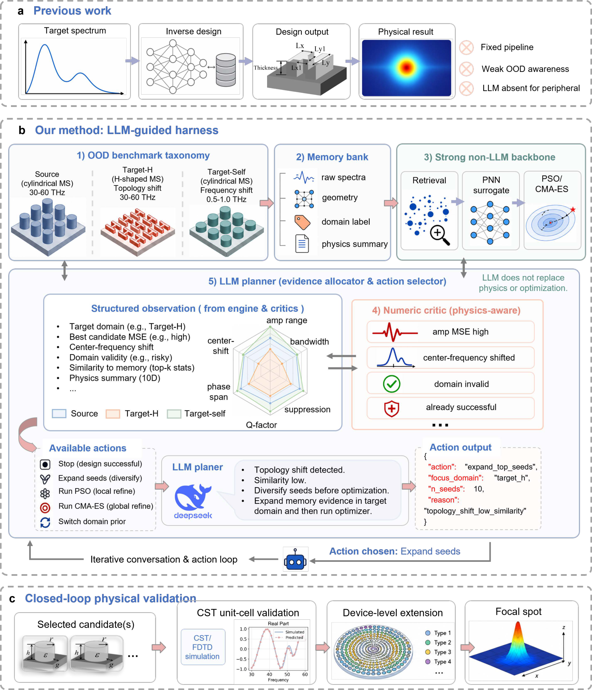
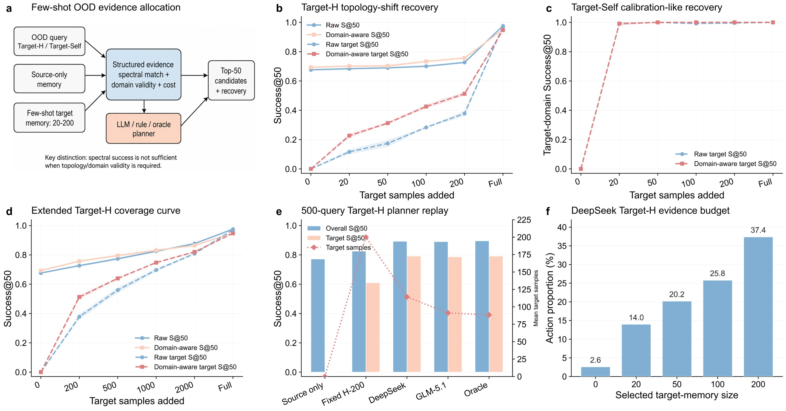
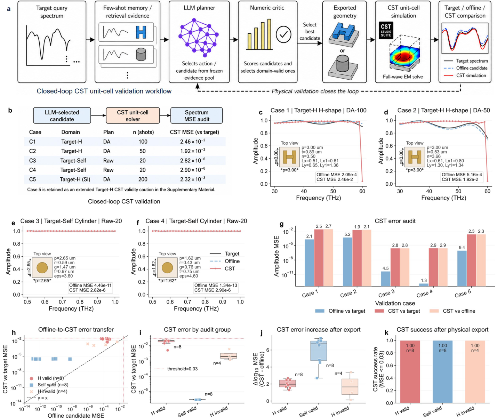
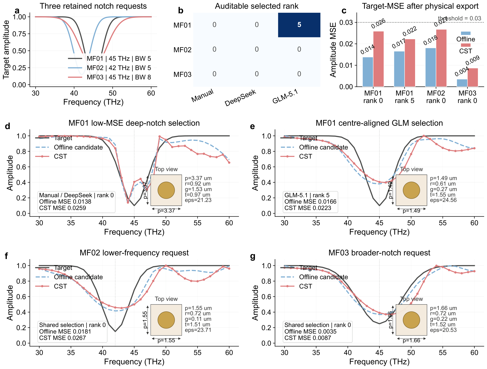

<div align="center">

# Attribution-Aware Benchmarking for LLM-Assisted Inverse Design of Metasurfaces

[](https://www.python.org/)
[](https://pytorch.org/)
[](LICENSE)
[](#citation)

**Bowen Yu**<sup>1</sup>, **Nan Zhang**<sup>1</sup>, **Zhonglei Shen**<sup>1,2,\*</sup>, **Yushan Hou**<sup>1</sup>, **Liuyang Zhang**<sup>1,\*\*</sup>, **Asoke Kumar Nandi**<sup>3</sup>, **Ruqiang Yan**<sup>1</sup>, **Xuefeng Chen**<sup>1</sup>

<sup>1</sup> *School of Mechanical Engineering, Xi'an Jiaotong University, Xi'an 710049, China*  
<sup>2</sup> *School of Physical and Mathematical Sciences, Nanyang Technological University, 637371, Singapore*  
<sup>3</sup> *Department of Electronic and Electrical Engineering, Brunel University London, Uxbridge UB8 3PH, UK*

</div>

---

## Overview

Tool-augmented Large Language Model (LLM) agents promise flexible orchestration across heterogeneous photonic solvers, surrogates, and memory banks. However, when retrieval engines and deep surrogates already generate strong candidate pools, black-box end-to-end success metrics confound the LLM planner's actual decision value with the underlying numerical backbone—creating an **"illusion of agency."**

This repository implements an **attribution-aware evaluation framework** that cleanly isolates bounded LLM decision-making from numerical solvers in photonic inverse design:

- **Frozen Candidate Generation & Immutable Offline Policy Replay**: Candidate pools and physics-aware critics are frozen prior to replay, enabling strict apples-to-apples comparisons among **LLM planners** (DeepSeek, GLM-5.1), **rule-based policies**, **learned controls**, and **oracle upper bounds**.
- **Strict Evidence Partitioning**: Planner-visible structured observations (spectral similarity, physics summaries, domain validity cues) are strictly isolated from evaluation-only ground-truth outcomes.
- **Physically Auditable Multi-Regime Metasurface Testbed**: Spans **same-domain** (cylindrical meta-atoms, 30–60 THz), **topology-shift** (H-shaped meta-atoms, 30–60 THz), and **permittivity/frequency-shift** (0.5–1.0 THz) regimes with full-wave CST verification.
- **Key Finding**: While retrieval-seeded surrogate optimization accounts for most same-domain performance, LLM planners provide a clear **sample-efficiency advantage in few-shot topology-shift recovery**—achieving target-domain `Success@50` of **0.792 (DeepSeek)** and **0.787 (GLM-5.1)** with substantially fewer target-domain samples than fixed high-budget rules.

<p align="center">
  
  <br>
  <em>Figure 1: Overview of the attribution-aware language–physics evaluation harness for auditing bounded LLM agents in metasurface inverse design.</em>
</p>

---

## Selected Highlights

> *Note: This repository releases the core framework package, prompt schemas, configuration, and selected manuscript figures. Full raw query logs, checkpoints, and complete archival tables are omitted from this lightweight GitHub repository.*

<p align="center">
  
  <br>
  <em>Figure 2: LLM-guided few-shot OOD recovery via target-evidence allocation across topology-shift (Target-H) and frequency/material-shift (Target-Self) regimes.</em>
</p>

<p align="center">
  
  <br>
  <em>Figure 3: Full-wave CST electromagnetic audit of planner-selected OOD recovery cases.</em>
</p>

<p align="center">
  
  <br>
  <em>Figure 4: Bounded device-function extension to on-demand Gaussian-notch metasurface optical filter selection.</em>
</p>

---

## Repository Structure

```text
bounded-llm-photonic-inverse-design/
├── assets/                                  # Selected manuscript figures
├── configs/
│   └── experiment_v1.json                   # Unified multi-domain benchmark configuration
├── prompts/
│   ├── planner.md                           # Bounded LLM planner prompt template
│   ├── critic.md                            # Physics-aware critic prompt template
│   └── spec_parser.md                       # Optical specification parser template
├── src/my_llm_framework/
│   ├── config.py / schemas.py               # Configuration loader & structured evidence schemas
│   ├── features/physics_summary.py          # 10D spectral physics descriptors
│   ├── retrieval/                           # Raw & domain-aware memory bank retrieval
│   ├── models/ & surrogates/                # PNN forward surrogate, kNN surrogate & INN baseline
│   ├── optimization/                        # PSO, CMA-ES, and Powell local refinement
│   ├── critics/numeric_critic.py            # Physics-aware numeric critic
│   ├── planning/                            # Offline replay engine, heuristic & LLM policies
│   ├── evaluation/metrics.py                # Success@K, MSE, and budget metrics
│   └── scripts/                             # End-to-end dataset, evaluation & audit entrypoints
├── scripts/                                 # Publication plotting scripts
├── pyproject.toml
├── requirements.txt
└── REPRODUCIBILITY.md
```

---

## Quick Start

### 1. Environment Setup

```bash
git clone https://github.com/ybw110/bounded-llm-photonic-inverse-design.git
cd bounded-llm-photonic-inverse-design
python -m venv .venv
source .venv/bin/activate        # On Windows: .\.venv\Scripts\Activate.ps1
pip install -r requirements.txt
pip install -e .
```

### 2. Core Pipeline Execution Order

Prepare the processed multi-domain dataset and memory bank, then run retrieval, surrogate optimization, and offline policy replay:

```bash
python -m my_llm_framework.scripts.prepare_processed_dataset --config configs/experiment_v1.json
python -m my_llm_framework.scripts.build_memory_bank --config configs/experiment_v1.json
python -m my_llm_framework.scripts.evaluate_retrieval_baselines --config configs/experiment_v1.json
python -m my_llm_framework.scripts.evaluate_retrieval_optimizer --config configs/experiment_v1.json
python -m my_llm_framework.scripts.evaluate_llm_planner_offline --config configs/experiment_v1.json
python -m my_llm_framework.scripts.evaluate_llm_ood_recovery_planner --config configs/experiment_v1.json
```

> **API Credentials:** Private LLM API keys (DeepSeek / GLM-5.1) are never stored in this repository. Provide keys via environment variables when invoking live LLM planners.

---

## Citation

If you find this framework useful in your research, please consider citing:

```bibtex
@article{yu2026attribution_llm_metasurface,
  title   = {Attribution-Aware Benchmarking for LLM-Assisted Inverse Design of Metasurfaces},
  author  = {Yu, Bowen and Zhang, Nan and Shen, Zhonglei and Hou, Yushan and Zhang, Liuyang and Nandi, Asoke Kumar and Yan, Ruqiang and Chen, Xuefeng},
  journal = {Submitted},
  year    = {2026}
}
```

## License

This project is released under the [MIT License](LICENSE).
